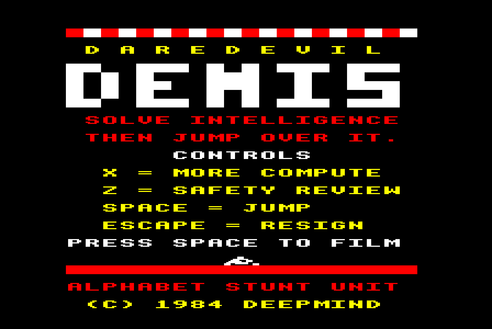
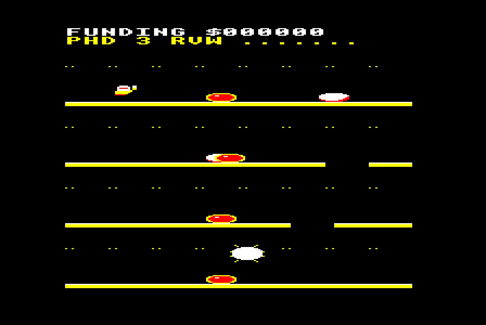
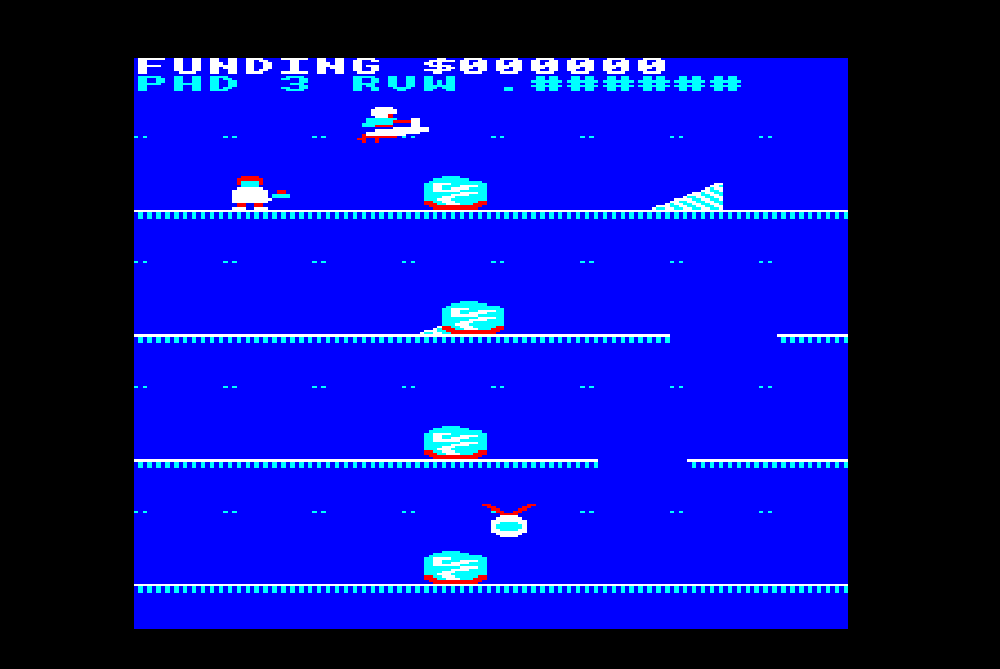
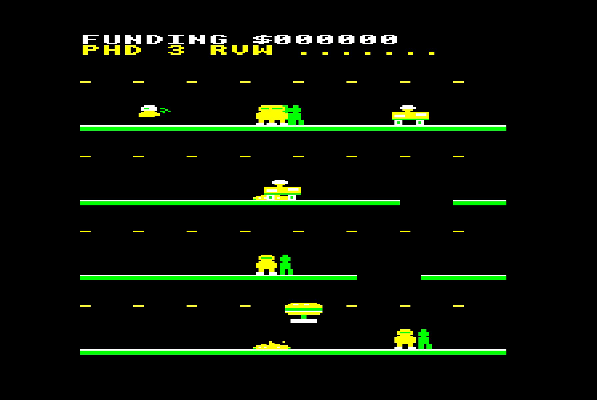
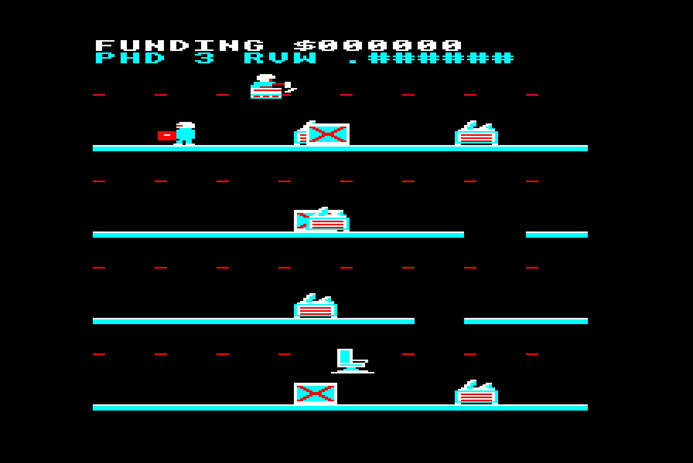
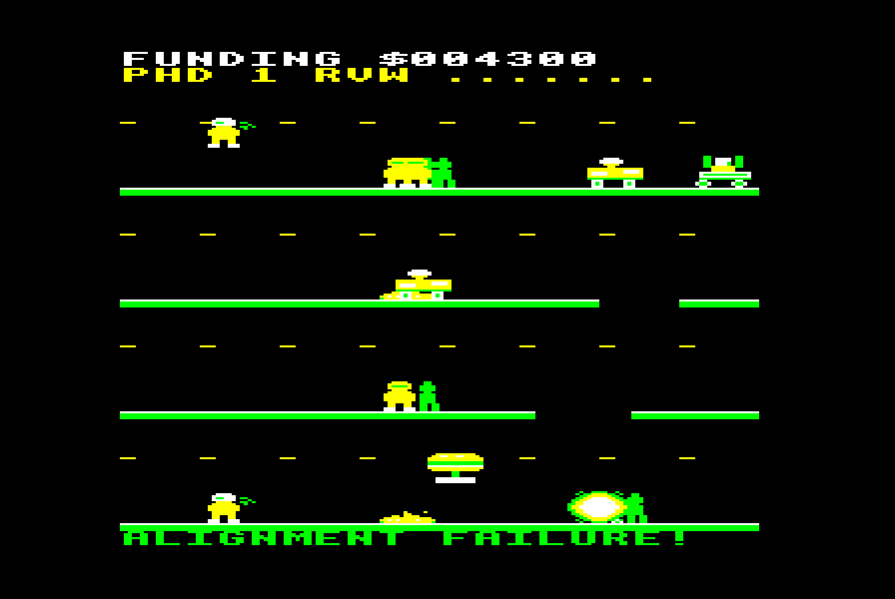
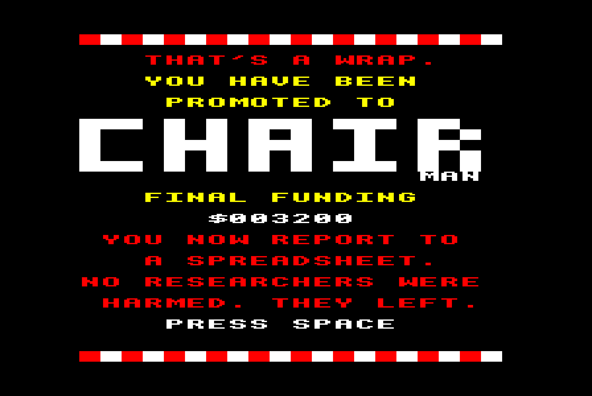

# DAREDEVIL DEMIS

A spoof of **Daredevil Dennis** (Visions Software, 1984) for the BBC Micro,
written in 6502 assembly, starring a certain Nobel-winning, chess-playing,
Theme-Park-designing, recently-promoted-sideways AI researcher.

> Step one, solve intelligence. Step two, jump over it.

### ▶ [**Play it in your browser**](https://bbc.xania.org/?disc=https://raw.githubusercontent.com/mattgodbolt/daredevil-demis/main/daredevil-demis.ssd&autoboot)

That link hands [jsbeeb](https://github.com/mattgodbolt/jsbeeb) the disc image
straight from this repo's raw URL — which serves
`access-control-allow-origin: *`, so no download and no proxy — and autoboots
it on a BBC B with DFS 1.2.



Four shoots. Four platforms each. Three controls. One stuntman whose employer
has just restructured him into a chairmanship.

## Playing it

[Play it in your browser](https://bbc.xania.org/?disc=https://raw.githubusercontent.com/mattgodbolt/daredevil-demis/main/daredevil-demis.ssd&autoboot), or grab
[`daredevil-demis.ssd`](daredevil-demis.ssd) and drop it into any BBC Micro
emulator. It autoboots on SHIFT+BREAK, or `*RUN Code` from the disc.

| Key      | Does                                     |
|----------|------------------------------------------|
| `X`      | Accelerate — "MORE COMPUTE"              |
| `Z`      | Brake — "SAFETY REVIEW"                  |
| `SPACE`  | Jump                                     |
| `ESCAPE` | Resign                                   |

There is no left, no right, and no up. As in the original, **the whole game is
deciding how fast to be going before you leave the ground.** You always ride
rightwards; run off the end of a platform and you reappear at the start of the
next one down. Fall through a hole and you drop a lane early, which is
sometimes a shortcut and sometimes the last thing you do.

Your wage is paid in **FUNDING**. Your lives are **PHDs**. And the `RVW` bar on
the status line is the safety review slowly catching up with anyone who dawdles —
stand still long enough and you are paused pending review, which counts as a
crash. It is, thematically, the most realistic part of the game.

## The four shoots

| | |
|---|---|
| **1. GO BOARD GORGE** — black and white stones on the intersections, and one bonus stone placed somewhere no human would ever have put it. |  |
| **2. PROTEIN FOLDING FJORD** — jet-ski over misfolded blobs and alpha-helix ramps, past an unresolved region, to a Nobel medal. |  |
| **3. THEME PARK HILL** — a love letter to Bullfrog. Queueing punters, ice-cream vans, and canonically, puddles of sick. Put the salt up. |  |
| **4. AGI SUMMIT** — uphill, all of it. Overheating TPU pods, crates marked DELAYED, and researchers hopping out of frame with their boxes. |  |

Crash and you get a message from the industry's rich vocabulary of failure:
`MODEL COLLAPSE!`, `HALLUCINATION!`, `COMPUTE EXHAUSTED!`, `DELAYED SIX MONTHS!`,
`TALENT EXODUS!`, `PIVOT TO AGENTS!`, `PROMOTED SIDEWAYS!` …



Run out of PHDs and you get the only ending the industry currently offers:



## Building

Needs [beebasm](https://github.com/stardot/beebasm):

```sh
make            # -> build/demis.ssd
```

## Testing

The game is developed and tested against a headless BBC Micro, driven through
the [jsbeeb MCP server](https://www.npmjs.com/package/jsbeeb-mcp). The harness
in `tools/` talks to that server over stdio, so it exercises exactly the same
path an AI assistant would.

```sh
npm install     # just the MCP client SDK
make run        # boot the disc, screenshot it
make test       # let the autopilot play the whole game
```

`tools/autopilot.mjs` is the interesting one. It parses `src/levels.asm` with
the same walk the engine uses, watches the game's own variables through
`read_memory`, and holds accelerate / brake / jump accordingly. A passing run
looks like:

```
score  $004300
crashes 3  lanes reached 0:0 0:1 0:3 0:4 1:0 1:1 1:3 1:4 2:0 2:1 2:3 2:4 3:0 3:1 3:2 3:3 3:4
```

That is every lane of every shoot, plus a second lap at higher difficulty. It
is a slow, dumb bot; if it can get round, a human can.

Other tools:

| Tool | Does |
|---|---|
| `tools/beeb.js` | boot a disc, hold keys, screenshot, peek memory, dump the screen |
| `tools/play.mjs` | run a scripted key sequence, capturing shots and screen dumps at named points |
| `tools/screen.py` | render a 10K MODE 5 screen dump as ASCII, one character per pixel |
| `tools/gen_sprites.py` | turn the ASCII artwork into `src/sprites.asm` |
| `tools/preview_sprites.py` | decode `src/sprites.asm` back to ASCII and check it round-trips |

`tools/screen.py` earned its keep: when something looks wrong, a text dump of
the actual pixels settles in seconds what a screenshot can only suggest.

## How it works

MODE 5 — 160×256, four colours, 10K of screen at `&5800`. The code lives at
`&1900` and is a single `Code` file; `!BOOT` just `*RUN`s it.

- **Playfield.** Four lanes 56 pixels tall, a two-character status bar at the
  top and a message line at the bottom. Scenery and static hazards are painted
  once per shoot; only the rider and the movers are redrawn.
- **Sprites** are 16×16, stored as interleaved (data, mask) byte pairs so a
  blit is `screen = (screen AND mask) OR data` with no table lookup in the
  inner loop. The rider's two frames are pre-shifted into four pixel phases at
  the start of each shoot, which buys smooth horizontal movement for 1280 bytes.
- **Redraw** saves the background under each sprite and restores it from the
  address it was actually drawn at, so the whole update happens before the
  vsync. Every background is saved before anything is drawn — otherwise the
  second sprite saves the first one's pixels and smears a copy of it down the
  track. The blitter unrolls a character row at a time and patches its own
  operands once per sprite; the whole redraw costs about 82 scanlines.
- **No OS in the game loop.** `OSWRCH` costs more than a frame for a status
  bar, so text is plotted straight from the MOS font at `&C000`; and `OSBYTE
  19` returns too late to be a vsync, so the engine hooks `IRQ1V` and counts
  them itself. Since the redraw is longer than the vertical border, it waits
  for the beam to drop *below* the lane it is about to repaint — so the rider
  is painted every frame on every lane, rather than a third of the time on the
  top one.
- **Physics** is 8.8 fixed point: 1.25 px/frame flat out, a 4 px/frame jump
  against 0.25 gravity, and a constant drag so you always coast to a halt. That
  is a 32-pixel-high, 42-pixel-long leap that shelters about 33 pixels of
  ground — which is what dictates the whole level layout.
- **Collision** is logical, not pixel: boxes from the level table, nine pixels
  of slop each way. Predictable beats accurate.
- **Sound** is `OSWORD 7` with envelopes; the engine note tracks speed and only
  re-issues a command when the pitch band changes.

## Layout

```
src/defs.asm       shared constants: screen geometry, sprite format, sprite ids
src/engine.asm     the game: physics, collision, blitter, status bar
src/levels.asm     the four shoots as data
src/sprites.asm    26 sprites, generated from tools/gen_sprites.py
src/sound.asm      effects and jingles
src/titles.asm     title, shoot cards, game over, crash messages
src/main.asm       build file
src/main_dbg.asm   drops straight into one shoot, for testing
```

## Licence

Everything in this repository is MIT licensed (see [LICENSE](LICENSE)). *Daredevil
Dennis* itself, which this spoofs, is Visions Software's; see Credits.

## Credits

Original *Daredevil Dennis* by Visions Software, 1984 — the four-platform
layout, the three controls and the wage-not-score idea are all theirs.

Written with Claude Code. See [RETROSPECTIVE.md](RETROSPECTIVE.md) for how that
went, including the bugs that cost the most time.

No researchers were harmed. They left.
